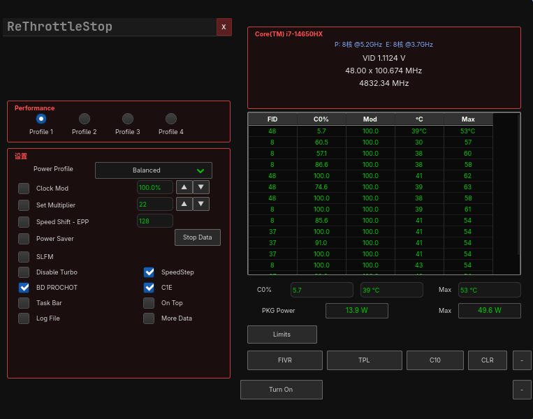
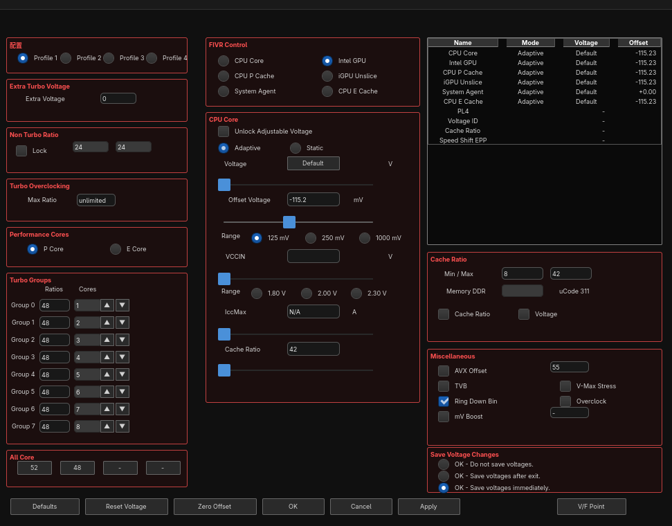
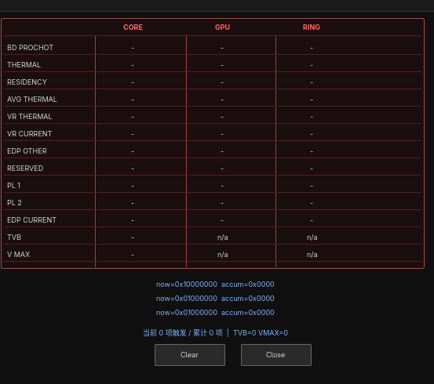

# ReThrottleStop

[English](README.en.md) | [简体中文](README.md)

Intel FIVR voltage and frequency control for Linux.



## Overview

ReThrottleStop adjusts per-domain CPU voltage offsets through the Intel FIVR
mailbox (MSR `0x150`), sets ratio limits through HWP-related registers, and
monitors frequency, voltage, temperature and power in real time.

The backend is C++17; the frontend is GTK4 (C API). Privileged operations are
performed by a dedicated systemd daemon. The GUI process holds no capabilities.

## Features



### Voltage (FIVR)

- Six independently adjustable domains: CPU Core, Intel GPU, CPU P Cache,
  iGPU Unslice, System Agent, CPU E Cache
- Offsets encoded as `raw12 = 2048 - |mV| × 1.024`, stored in FIVR mailbox
  command bits `[32:21]`
- The data panel reads hardware return values; it does not echo user input
- Offsets persist to a configuration file

### Frequency

- Turbo Groups: 8-ratio ladder with All-Core shortcuts and P/E core views
- Target-frequency conversion: enter a target ratio (48 means 4.8 GHz); the
  value is translated to the register value via a calibration table
- Speed Shift EPP: written as `(EPP << 8) | EPP` to MSR `0x772`

### Monitoring



- Per-core table: FID, C0%, modulation duty, temperature, per-core peak
- VID voltage: decoded from MSR `0x198[47:32]`, unit 1/8192 V
- Package power: RAPL via `powercap` sysfs, 64-bit counter differencing
- Limit reasons: 13-row panel with accumulated bit mask

### System integration

- The daemon runs in `system.slice` and is not terminated with the graphical
  session
- Single-instance GUI (D-Bus application ID)
- Full control-state persistence
- Tray menu (`com.canonical.dbusmenu`): profile switching, quit

## Installation

### From source

```bash
git clone https://github.com/FoxHMM/rethrottlestop.git
cd rethrottlestop
make
sudo make install-staging
sudo modprobe msr
sudo systemctl enable --now rethrottlestop-daemon.service
```

Dependencies: `gtk4`, `glib2`, `systemd`, `gcc`, `pkgconf`

## Architecture

```
GUI process (GTK4, unprivileged)
    │  Unix socket  /run/rethrottlestop/msr.sock
    │  text protocol: R / W / I / C / M / N / S
Daemon (CAP_SYS_RAWIO, system.slice)
    │  /dev/cpu/0/msr
Intel FIVR mailbox (MSR 0x150)
```

Writes to the FIVR mailbox are serialized on CPU 0 with a minimum 20 ms gap.
Concurrent writes to this mailbox trigger PCIe bus errors on some platforms;
the serialization is required.

## Unimplemented and unverified

The following are either unimplemented or not verified:

| Item | Status |
|---|---|
| AVX Offset write | Not implemented. The reference implementation writes MSR `0x1AD` with a complete 64-bit value; a partial write corrupts the ratio table held in that register, so writing is currently refused |
| PROCHOT temperature edit | Not implemented (MSR `0x1B1`) |
| TPL panel | Partially implemented (MSR `0x770`, `0x017`, `0x194`) |
| Thermal Velocity Boost | Gated by a CPU-model whitelist. Not written when the model does not match; the checkbox is greyed out |
| V-Max Stress | Return bit of MSR `0x150`, read-only; greyed out |
| Ring Down Bin | Return bit of MSR `0x150`, read-only; greyed out |
| mV Boost | No corresponding MSR field |
| E-core ratio limit | Hardware-limited. Writes succeed, but values above the hardware ceiling do not take effect |
| Frequency write precondition | On some platforms the value is only honoured when the system power profile is `performance` |
| HWP_REQUEST field writes | Return `EIO` on some platforms; fields are firmware-locked |
| Other CPU models | Untested |
| Other chipsets | Untested |
| State after suspend/resume | Untested |
| Multi-socket systems | Not considered |
| KDE / GNOME tray menu | Untested |

See [TODO.md](TODO.md) for details.

## Compatibility

Functionality has been verified on a single configuration: an Intel hybrid
processor (P-cores + E-cores), Linux kernel 6.x or later, a Wayland compositor,
and Arch Linux.

FIVR mailbox behaviour, ratio register layout and HWP behaviour all depend on
firmware implementation and may differ on other platforms.

## References

| Project | Use |
|---|---|
| [ThrottleStop](https://www.techpowerup.com/download/techpowerup-throttlestop/) | Behavioural reference. This project is an independent implementation; no code from it is included or redistributed |
| [intel-undervolt](https://github.com/kitsunyan/intel-undervolt) | FIVR offset encoding cross-check; daemon design reference |
| [undervolt](https://github.com/georgewhewell/undervolt) | FIVR offset protocol cross-check |
| [GTK](https://gtk.org/) | UI toolkit (GTK4, C API) |
| [systemd](https://systemd.io/) | Daemon supervision and capability bounding |

## Development notes

The verification methodology and known pitfalls encountered during
implementation are documented in [DEVELOPMENT.md](DEVELOPMENT.md).
All register semantics are based on measured data rather than documentation
inference.

## License

MIT, see [LICENSE](LICENSE).
