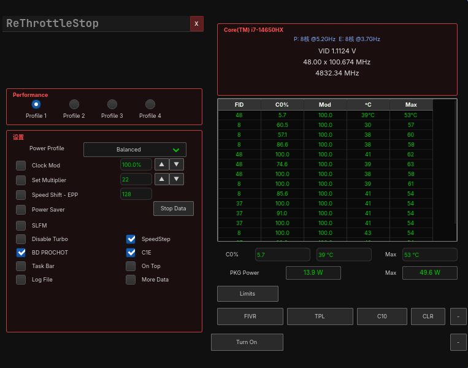
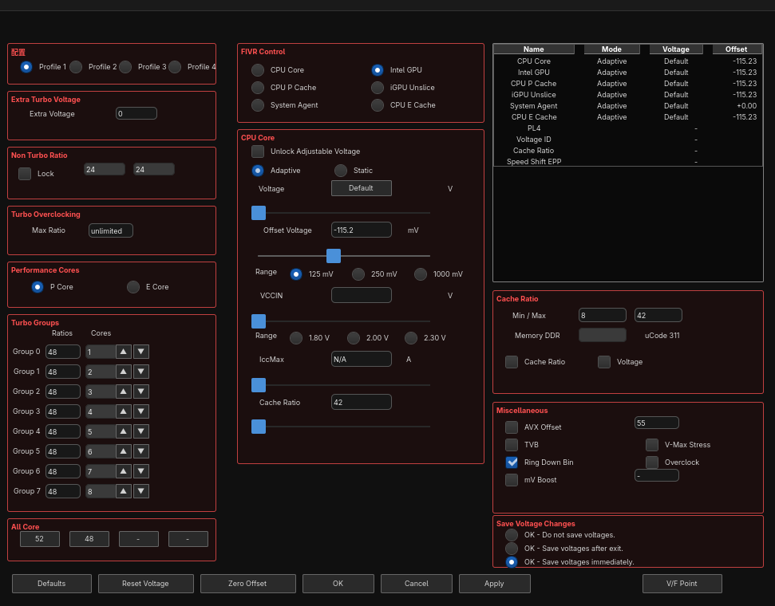
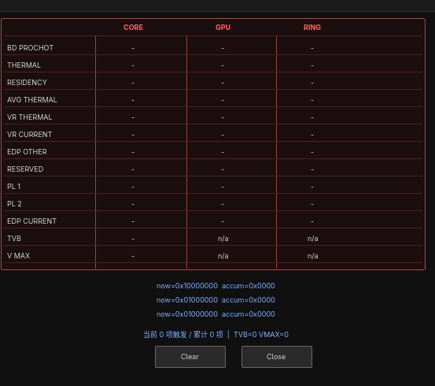

# ReThrottleStop

[English](README.en.md) | [简体中文](README.md)

Linux 下的 Intel FIVR 电压与频率控制工具。



## 概述

ReThrottleStop 通过 Intel FIVR 邮箱（MSR `0x150`）调节 CPU 各电压域偏移，
通过 HWP 相关寄存器设置倍频上限，并实时监控频率、电压、温度与功耗。

后端为 C++17，前端为 GTK4（C API）。特权操作由独立的 systemd 守护进程执行，
GUI 进程不持有任何 capability。

## 功能



### 电压调节（FIVR）

- 六个电压域独立偏移：CPU Core、Intel GPU、CPU P Cache、iGPU Unslice、
  System Agent、CPU E Cache
- 偏移编码为 `raw12 = 2048 - |mV| × 1.024`，位于 FIVR 邮箱命令 bit `[32:21]`
- 数据面板读取硬件返回值，不回显输入值
- 偏移值可持久化到配置文件

### 频率控制

- Turbo Groups：8 档倍频阶梯，含 All-Core 快捷设置与 P/E 核视图切换
- 目标频率换算：界面输入目标频率（如 48 表示 4.8 GHz），
  内部按标定表换算为寄存器值
- Speed Shift EPP：按 `(EPP << 8) | EPP` 写入 MSR `0x772`

### 监控



- 逐核数据表：FID、C0%、调制占空比、温度、逐核峰值
- VID 电压：由 MSR `0x198[47:32]` 解码，单位 1/8192 V
- 封装功耗：通过 `powercap` sysfs 读取 RAPL，64 位计数器差分
- 限流原因：13 行面板，带累积位图

### 系统集成

- 守护进程位于 `system.slice`，不随图形会话结束而终止
- GUI 单实例（D-Bus 应用 ID）
- 控件状态完整持久化
- 托盘菜单（`com.canonical.dbusmenu`）：配置切换、退出

## 安装

### 从源码

```bash
git clone https://github.com/FoxHMM/rethrottlestop.git
cd rethrottlestop
make
sudo make install-staging
sudo modprobe msr
sudo systemctl enable --now rethrottlestop-daemon.service
```

依赖：`gtk4`、`glib2`、`systemd`、`gcc`、`pkgconf`

## 架构

```
GUI 进程（GTK4，无特权）
    │  Unix socket  /run/rethrottlestop/msr.sock
    │  文本协议：R / W / I / C / M / N / S
守护进程（CAP_SYS_RAWIO，system.slice）
    │  /dev/cpu/0/msr
Intel FIVR 邮箱（MSR 0x150）
```

对 FIVR 邮箱的写入在 CPU 0 上串行执行，间隔不小于 20 ms。
并发写入该邮箱在部分平台上会触发 PCIe 总线错误，此约束为必需项。

## 未实现与存疑功能

以下功能未实现，或行为未经验证：

| 功能 | 状态 |
|---|---|
| AVX Offset 写入 | 未实现。参考实现以完整 64 位值写 MSR `0x1AD`，部分写入会破坏该寄存器中的倍频表，故当前禁止写入 |
| PROCHOT 温度编辑 | 未实现（MSR `0x1B1`） |
| TPL 面板 | 部分实现（MSR `0x770`、`0x017`、`0x194`） |
| Thermal Velocity Boost | 依赖 CPU 型号白名单。型号不匹配时不写入，复选框置灰 |
| V-Max Stress | MSR `0x150` 返回位，硬件只读，界面置灰 |
| Ring Down Bin | MSR `0x150` 返回位，硬件只读，界面置灰 |
| mV Boost | 无对应 MSR 字段 |
| E 核倍频上限 | 受硬件限制。写入成功但超过硬件上限的值不生效 |
| 频率写入生效条件 | 部分平台上需系统电源模式为 `performance` 才被硬件采纳 |
| HWP_REQUEST 字段写入 | 部分平台返回 `EIO`，字段被固件锁定 |
| 其他 CPU 型号 | 未测试 |
| 其他芯片组 | 未测试 |
| 休眠 / 唤醒后状态 | 未测试 |
| 多路 CPU | 未考虑 |
| KDE / GNOME 托盘菜单 | 未测试 |

详细说明见 [TODO.md](TODO.md)。

## 兼容性

已在单一配置上完成功能验证：Intel 混合架构处理器（P 核 + E 核）、
Linux 内核 6.x 以上、Wayland 合成器、Arch Linux。

FIVR 邮箱行为、倍频寄存器布局与 HWP 行为均依赖固件实现，
在其他平台上可能存在差异。

## 参考项目

| 项目 | 用途 |
|---|---|
| [ThrottleStop](https://www.techpowerup.com/download/techpowerup-throttlestop/) | 行为参考。本项目为独立实现，不包含也不分发其任何代码 |
| [intel-undervolt](https://github.com/kitsunyan/intel-undervolt) | FIVR 偏移编码交叉验证；守护进程设计参考 |
| [undervolt](https://github.com/georgewhewell/undervolt) | FIVR 偏移协议交叉验证 |
| [GTK](https://gtk.org/) | UI 工具包（GTK4，C API） |
| [systemd](https://systemd.io/) | 守护进程托管与 capability 约束 |

## 开发说明

实现过程中形成的验证方法与已知陷阱记录于 [DEVELOPMENT.md](DEVELOPMENT.md)。
所有寄存器语义均以实测数据为准，不以文档推断为准。

## 许可证

MIT，见 [LICENSE](LICENSE)。
